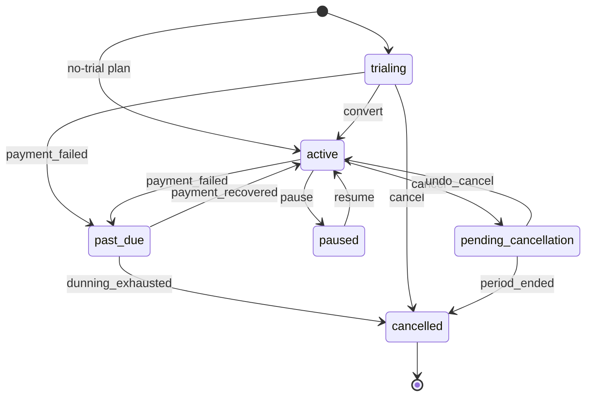

# Subscription state machine (P0-2)

The table in `src/subscriptions/state.ts` is the single source of truth. A status changes only
through `transition()` in `src/subscriptions/transition.ts`, which validates the move, updates the
row only if its status is still the one it read, and appends an audit event in the same transaction.
The diagram below is generated by `diagram()`; `tests/unit/subscription-state.test.ts` fails if it
drifts from the table. Regenerate it with:

    npx tsx -e "import {diagram} from './src/subscriptions/state.ts'; console.log(diagram())"

## Rules

- Any (status, event) pair not drawn above is refused with `InvalidTransition`, before any write.
- `cancelled` is terminal.
- Pausing a trial is refused (P0-7): `pause` exists only from `active`.
- Involuntary churn is `dunning_exhausted`; voluntary is `cancel` then `period_ended` (or `cancel`
  during a trial). The audit `action` (`subscription.<event>`) keeps them apart for reporting (P0-6, P1-1).
- Edges the PRD does not list, taken as defaults (D-002): a trial can be cancelled straight to
  `cancelled`, and a failed trial-conversion charge moves `trialing → past_due` into dunning.

## Audit event

Every transition writes one `AuditEvent` (append-only, INV-19): `action = subscription.<event>`,
`targetType = subscription`, `targetId`, `actorUserId` (null for a system job), `at`, and
`data = { from, to }`.
